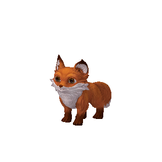
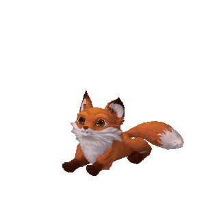
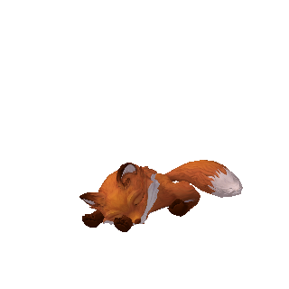
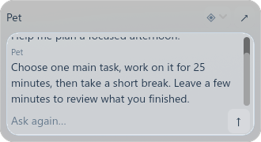
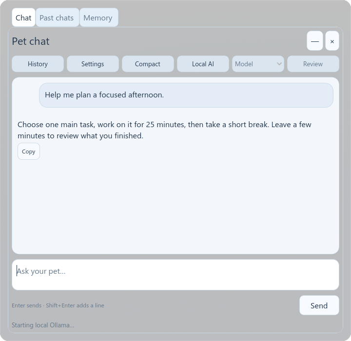
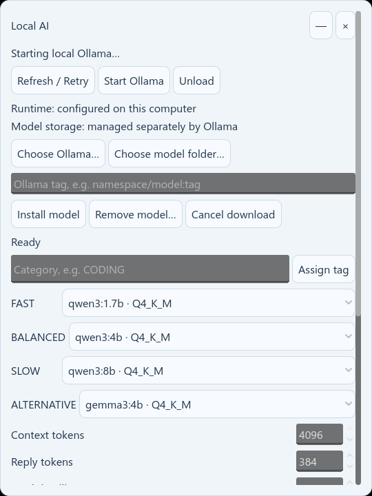
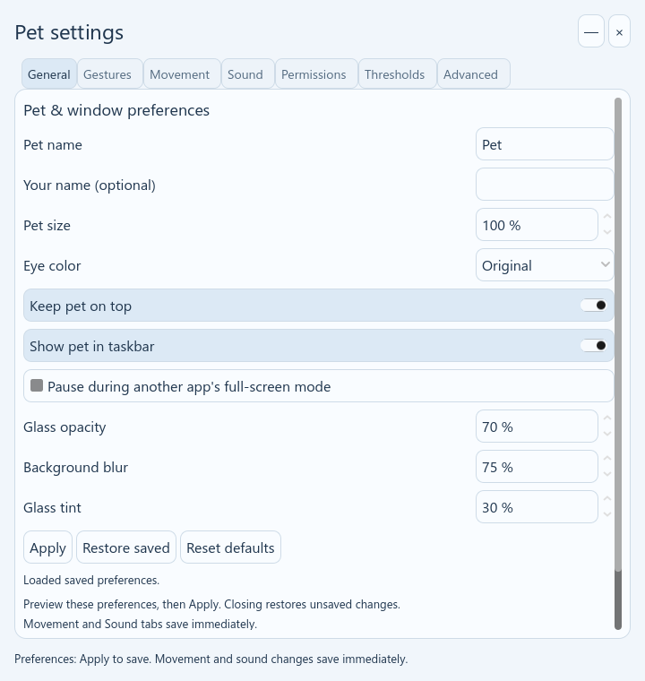
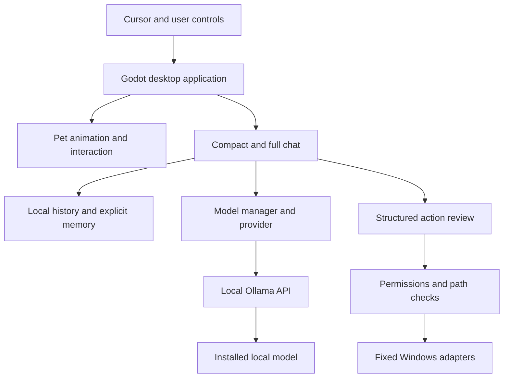

# Desktop Pet

**An animated local-AI desktop companion for Windows.**

[Getting started](#getting-started) · [Interactions](#interactions) · [Local AI](#local-ai-and-models) · [Privacy](#data-and-privacy) · [Development](#building-and-contributing)

<p align="center"></p>

Desktop Pet began with a simple idea: a virtual pet should live on the desktop, rather than remain inside a normal application window. The fox watches nearby cursor movements, follows when invited, settles down to rest, and opens a small chat interface when you need it.

It combines an animated desktop pet, mouse interactions, local AI chat, persistent conversations, explicit long-term memory and permission-controlled Windows actions. **The pet works without AI. Chat requires Ollama and at least one compatible local model.**

Created and maintained by **Abir Dutta** ([ADworld05](https://github.com/ADworld05)). Original project code is MIT licensed; the fox model and other dependencies retain their own licenses.

> **Status:** the current build is an unsigned Windows x64 release candidate, `1.0.0-rc.6`. Public release assets and source publication are being prepared. Check [Releases](https://github.com/ADworld05/Desktop-Pet/releases) for availability; a downloadable package may not yet be published. Portable and standalone-setup source build commands are provided; the manual CI draft has not run remotely—see [BUILDING.md](BUILDING.md).

## Contents

- [Features](#features)
- [Interactions](#interactions)
- [Rest and sleep](#rest-and-sleep)
- [Chat interfaces](#chat-interfaces)
- [Getting started](#getting-started)
- [Local AI and models](#local-ai-and-models)
- [History and long-term memory](#history-and-long-term-memory)
- [Windows actions and permissions](#windows-actions-and-permissions)
- [Customization](#customization)
- [Data and privacy](#data-and-privacy)
- [Requirements and performance](#requirements-and-performance)
- [Moving to another computer](#moving-to-another-computer)
- [Architecture and source layout](#architecture-and-source-layout)
- [Building and contributing](#building-and-contributing)
- [Troubleshooting and limitations](#troubleshooting-and-limitations)
- [License and attribution](#license-and-attribution)

## Features

| Area | Implemented behavior |
|---|---|
| Animated companion | Standing, sitting, walking, running, turning, lying, sleeping, waking and interaction animations |
| Cursor awareness | Smoothed eye and head/neck tracking relative to body orientation |
| Following | Hold-and-move activation, delayed target, curved travel, sharp-reversal handling and gradual arrival |
| Chat | Compact/full windows, streaming, Stop, model selection and Copy |
| Saved information | Past chats and explicit memory with inspection, editing, reviewed import and export |
| Windows integration | Tray recovery, hide/show, click-through, taskbar/topmost preferences and single-instance recovery |
| Controlled actions | Fixed Windows actions behind folder/application permissions and review |

## Interactions

| Interaction | Behavior |
|---|---|
| Cursor near fox | Eyes and head/neck track nearby movement |
| Single left-click body | Open compact chat |
| Click fox again or outside compact chat | Dismiss the popup |
| Double-click | Jump-to-sit interaction |
| Hold body, then move away | Activate follow once the hold and distance gates are met |
| Move while holding | Follow the delayed cursor target |
| Release after following | Finish toward the last recorded target, slow down and settle |
| Right-click | Open the fox menu |
| Tray icon | Access/recover the fox, hide/show, sleep/wake, restore input and exit |

Default follow activation is approximately **one second held** and **275 pixels of separation**. Target delay is **50 ms**, with a **120-pixel final approach**. Follow/turning thresholds are configurable; display scaling and pet size affect how they feel.

The fox normally runs during meaningful travel and walks near arrival. Smaller direction changes steer through a route; near-reversals can use a deliberate turn. Screen boundaries constrain travel. This is animated screen-space locomotion, rather than dragging a static model.

## Rest and sleep

Inactivity mainly follows cursor proximity to the fox, rather than whether you use other applications.

1. After about **three continuous minutes** without nearby interaction, the fox prepares to rest and moves toward a suitable nearby corner when needed.
2. It slows, settles with a slight angle and lies with its body/paws grounded and head raised.
3. After another **five minutes in the resting lie state**, it lowers its head and closes its eyes to sleep.
4. Cursor proximity wakes it and resets the inactivity cycle.

It stays at its resting location until an explicit interaction requires movement. Rest timing is currently built into the policy; movement/arrival parameters are configurable. Manual Sleep/Wake is available. Optional full-screen pausing is **off by default**; when enabled, return includes a ten-second quiet period.

| Lying, head raised | Sleeping, head lowered |
|---|---|
|  |  |

## Chat interfaces

### Compact chat



The popup sits beside the fox and is clamped to the usable screen area. Nominal size is **330 px wide**, around **100 px high** for input and capped around **180 px high** for answers.

- Model control, New Chat and Expand in a small header.
- Bounded input with scrolling instead of unlimited growth.
- Streamed current exchange with newest-content scrolling and manual review.
- Send becomes **Stop** during generation; stopping keeps partial output.
- Earlier conversation history stays accessible through the full window.

### Full chat



Expand retains the current conversation in **Desktop Pet — Chat**. The larger interface provides a chronological scrollable transcript, input at the bottom, model selection, Past chats, Memory, Settings and Local AI. It supports dragging, minimizing, restoring and closing.

Closing chat does not exit the pet. Relaunching the pet starts a fresh conversation while retaining saved chats and memory. New Chat also starts a fresh conversation during a session.

### Glass interface

Chat and the small fox menu use translucent glass-style surfaces with native Windows background effects and highlights. Important conversation/input surfaces stay substantially opaque. Opacity, blur and tint are configurable; appearance depends on Windows, graphics support and the background.

*Images are rendered from the current application with synthetic conversation data. They exclude the Windows desktop and native title bars; render textures do not reproduce native desktop blur. The sample answer is illustrative, not an inference benchmark.*

## Getting started

When packages are available, open [GitHub Releases](https://github.com/ADworld05/Desktop-Pet/releases).

### Installer

1. Download **DesktopPet_Setup.exe**.
2. Exit any running fox through its menu/tray **Exit** action.
3. Run setup and choose **Install / Update**.
4. Enable optional Desktop, Start-menu or sign-in shortcuts only if wanted.
5. Choose **Open installed pet**.

Default installation is current-user `%LOCALAPPDATA%\Programs\DesktopFox`, without administrator access. Setup does not silently install Ollama or models.

### Portable archive

1. Download **DesktopPet_Portable.zip**.
2. Extract the complete archive.
3. Keep all files in the extracted `DesktopPet` folder together.
4. Run **DesktopPet.exe**.

`DesktopPet.exe` is the launcher; `DesktopFox.exe` is the internal engine. Compatibility filenames and data folders retain their old names; visible product labels use Desktop Pet. Do not move just one executable. Portable program files can move, but saved data still uses the Windows user profile.

### First launch

First-run checks cover required assets, writable data and Ollama discovery. Continue fresh or review an optional previous-data import. Missing Ollama does not prevent pet-only use. Try hover, compact chat and tray recovery before adjusting settings.

## Local AI and models

### First-time AI setup

1. Install/start [Ollama for Windows](https://ollama.com/download), using a runtime compatible with your model.
2. Click the fox, **Expand**, then open **Local AI**.
3. Use **Refresh / Retry**. If needed, select the actual existing executable/model store in host controls.
4. Choose an installed compatible local model, or enter a model tag in the model-management controls and explicitly install it. Wait for progress to finish.
5. Refresh, select the model and send a short question.

Alternatively, with Ollama installed and running, use a terminal:

```powershell
ollama pull qwen3:1.7b
ollama list
```

Refresh Desktop Pet afterwards. These are terminal commands, not fox chat prompts. See the [Ollama CLI reference](https://docs.ollama.com/cli).

Internet is normally needed to acquire Ollama/model weights. Once supported weights are local, normal inference uses the local Ollama service without a cloud LLM service or cloud API key. Desktop Pet does not automatically fall back to cloud inference.

### Model choices

| Category | Example | Intended use |
|---|---|---|
| FAST | `qwen3:1.7b` | Default everyday chat |
| BALANCED | `qwen3:4b` | More involved questions |
| SLOW | `qwen3:8b` | Manually selected demanding questions |
| ALTERNATIVE | `gemma3:4b` | Alternative general-purpose model |

**These are recommendations, not requirements. One compatible model is enough.** Installed models are detected dynamically. Controls support refresh, selection, install by tag, removal after confirmation and preferred/custom category assignments. Adding a compatible local completion model should not require source changes.

Compatibility depends on runtime support, capabilities and verifiable local weights. Cloud-only models, unsupported formats and unusual custom storage/registry layouts are not automatically accepted. SLOW is not selected automatically. Weights remain managed by Ollama; they are not bundled or silently moved.



*Model entries in this preview are sample data, not a measurement of installed model sizes or performance.*

## History and long-term memory

**History** stores previous conversations for reopening. Storage/retention controls are available; storage is not unlimited.

**Memory** stores explicitly added or approved notes, separately from chat transcripts. It does not automatically extract every personal detail.

- Add notes in Memory or use `remember this: ...` in chat.
- Inspect, edit and delete notes.
- Export notes; review text/JSON imports before confirming storage.
- Opening an import file loads/reviews it rather than silently saving everything.
- Stored notes can be supplied as context for later answers, without a guarantee of perfect recall on every prompt.
- Export/recovery-copy cleanup is separate from active-note deletion.

Chats and memory are local files. **Desktop Pet does not encrypt them.** Protect backups/exports if they contain sensitive information.

## Windows actions and permissions

The fixed structured-action set includes opening approved applications/files/folders, bounded file search, revealing files in Explorer, bounded text reading, closing a selected application window and retrieving selected system information.

Allowed folders/applications are configured explicitly. Schema, path and scope checks precede execution, with action review and confirmations where required. An AI suggestion cannot grant itself access. Browsing a file for memory import does not grant ongoing folder permission.

Desktop Pet does **not** have unrestricted access, arbitrary shell execution, privilege elevation or a security-bypass mechanism. This is a restricted structured-action layer, not a general autonomous desktop agent.

## Customization



Settings are grouped into **General, Gestures, Movement, Sound, Permissions, Thresholds and Advanced**. Available preferences include:

- Pet name, optional user name, size and eye color.
- Topmost/taskbar behavior and optional full-screen pause.
- Cursor sensitivity, attention radius, smoothing and gesture timing.
- Follow hold/distance gates, delay, walk/run speeds, arrival distance and turning/reversal thresholds.
- Resting orientation angle, sound/mute/volume and glass opacity/blur/tint.
- Model choices and explicit permissions in the relevant panels.

Some preferences require **Apply**; movement and sound controls can save immediately. Follow each panel's save/restore note. The current build has one original fox coat, not a coat selector.

## Data and privacy

| Location | Data |
|---|---|
| `%APPDATA%\DesktopFox` | General settings, chats, memory and runtime data |
| `%LOCALAPPDATA%\DesktopFox\Config` | Machine-specific model/runtime preferences and permissions |
| Ollama's configured model directory | Model weights managed separately by Ollama |

Supported chat uses a local loopback Ollama endpoint. Model downloads contact the model service. Conversation context and selected saved notes supplied to the local model are processed by it. Local inference does not encrypt files or prevent other software with Windows access from reading them.

Exit and back up data before resets or migration. Uninstall is designed to preserve user data and model weights. Do not delete model/history folders to fix an unrelated launch issue.

## Requirements and performance

**Application:** Windows x64, tested on Windows 11; graphics drivers supporting the Compatibility renderer's OpenGL 3.3 requirements; sufficient storage for app/maintenance files. Other Windows versions/configurations are not comprehensively certified.

**Local AI:** RAM/VRAM and speed depend on model size, quantization, context and CPU/GPU capability. Smaller 1B–4B-class models are useful starting points, but their actual memory footprints vary. Around **16 GB RAM** is a practical recommendation for local-model use, not a certified universal minimum.

The default context is approximately **4K tokens**, with bounded output/time and one generation at a time. The app avoids intentionally retaining several large models simultaneously. Difficult reasoning prompts can exhaust their budget without a final answer. No universal frame-rate, battery or memory target is guaranteed.

## Moving to another computer

Transfer only the installer or complete portable archive. For AI, install Ollama and select/download at least one compatible model. The app uses that computer's own valid configuration; no particular drive letter or original workspace is required.

Packaged users need no Godot Editor, Blender, VS Code or Python. Re-select machine-specific paths/permissions instead of copying them blindly. Transfer notes through reviewed Memory export/import and back up existing data before broader migration.

## Architecture and source layout



Godot 4/GDScript implements pet behavior, UI and state systems. Native Windows bridges handle desktop/window/input/tray/glass integration. Local model requests/catalogs, history/memory and action policy remain separate components.

The prepared source-publication layout is:

```text
Desktop-Pet/
├── Source/
│   ├── Godot/           # Scenes, scripts and runtime_assets
│   ├── Native/          # Windows bridges and helper source
│   ├── Blender/         # Asset editing notes
│   └── Windows/         # Windows support material
├── Installer/Source/    # Installer UI and installation core
├── docs/images/         # Public application previews
├── Notices/             # Third-party licenses and attribution
├── BUILDING.md
├── AUTHORS.md
├── THIRD_PARTY_NOTICES.md
├── LICENSE
└── README.md
```

This describes the prepared source package, not a promise that all source files are already online. Release bundles are distributed separately. Personal runtime data, weights, caches and installed development tools are not source-publication inputs.

## Building and contributing

End users should use release packages. Developers need **Godot 4.7.2 Standard and matching Windows export templates**, a Windows C/MinGW toolchain and required project assets. Blender **4.5.9 LTS** is relevant for asset-authoring changes, not running the pet. Existing packaging utilities also use Python.

The portable application has a tested build entry point using existing Godot/MinGW tools. Run `python scripts/check_source.py`, then follow [BUILDING.md](BUILDING.md). Use `--installer` to also assemble and extraction-verify the standalone setup. A manual-only self-hosted Windows CI draft is included, but has not been run remotely. Interactive candidate install/update/uninstall review remains separate.

Contributions are welcome for portable builds/CI, compatibility testing, accessibility, documentation and measured performance improvements. Report Windows/app/model/runtime versions and reproduction steps. Redact chats, private paths and memory; never upload credentials or signing keys.

## Troubleshooting and limitations

| Problem | First checks |
|---|---|
| No fox | Keep all siblings together, launch `DesktopPet.exe`, check graphics drivers; relaunch can recover an existing instance |
| Hidden or ignores clicks | Tray Show/Restore input; check full click-through |
| Empty model list | Ollama availability, selected executable/store, installed local weights and Refresh |
| Slow/failed reply | Try a smaller compatible model, check free RAM/runtime support, use Stop |
| Follow does not activate | Start on body, keep holding, meet both gates; inspect Settings thresholds |
| Unreadable file picker | Current build uses native Windows appearance; report theme/scaling with a redacted screenshot |

Limits include unsigned binaries, driver-dependent glass/rendering, model-dependent latency/memory, bounded reasoning and display-dependent movement tuning. All graphics/DPI combinations, other physical PCs, very long/UNC paths and every sleep/audio-device transition are not universally certified.

Setup supports update, previous-version restore and data-preserving uninstall. A maintenance copy increases disk use. Guarded maintenance self-removal uses built-in Windows PowerShell; restricted environments may need the original external setup. Do not disable security protections to resolve an unknown warning.

<details>
<summary>Unsigned builds and future code signing</summary>

Current executables have no trusted publisher signature. Hashes identify release bytes but are not certificates. Signing requires a trusted identity/service, provider validation, protected keys and timestamps. Signed payloads require regenerated inventories, installer hashes and package tests; outer setup is signed after assembly. Self-signed test certificates are not equivalent to public trust, and signing does not guarantee removal of all reputation warnings.

</details>

## License and attribution

Original project code/documentation is under the [MIT License](LICENSE), copyright **2026 Abir Dutta**, with separate third-party licenses preserved. MIT permits commercial reuse and requires keeping its copyright/license notice.

The **Fox model and original animation assets are by pxltiger**, under CC BY 4.0 identified in the supplied asset metadata. Runtime animation and interaction modifications do not claim original authorship of the fox. Keep the detailed [fox attribution/modification notice](Notices/Fox-Attribution.md).

Godot, native dependencies, compiler runtime and sounds retain their notices. Ollama/models are separately installed and licensed. See [AUTHORS.md](AUTHORS.md) and [THIRD_PARTY_NOTICES.md](THIRD_PARTY_NOTICES.md).
